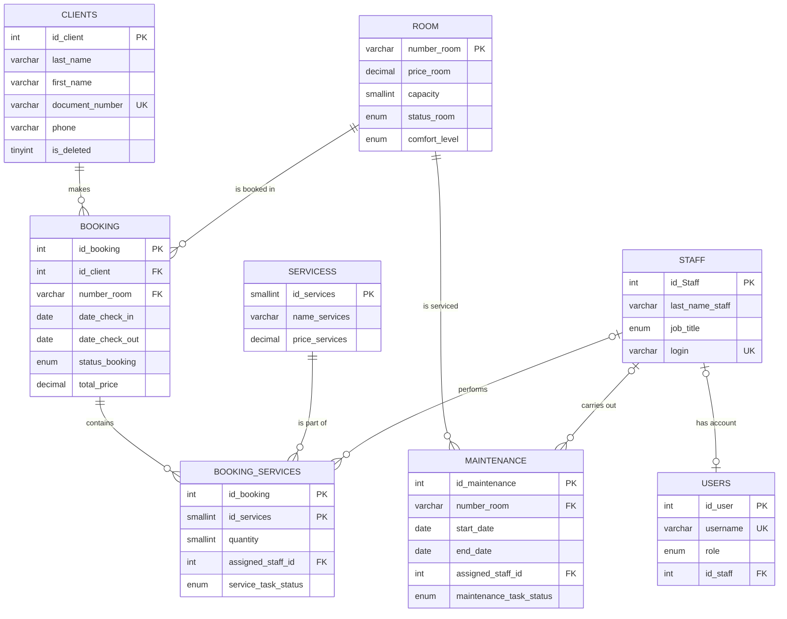

# 🏨 HOTEL_BD — Hotel Management Database

A relational database for **MySQL 8** that models the operation of a small hotel: clients, rooms, bookings, additional services, staff, room maintenance tasks, and user accounts with roles.

This repository is dedicated to the **design and implementation of the database**: from the verbal description of the subject area and the ER diagram to normalization, SQL scripts, views, stored procedures, a scheduled event, and backups.

---

## 📑 Table of Contents

1. [Subject Area Description](#-subject-area-description)
2. [Design Stages](#-design-stages)
3. [ER Diagram](#1-er-diagram-conceptual-model)
4. [Relational Model](#2-relational-model)
5. [Normalization](#3-normalization)
6. [Physical Schema](#4-physical-schema-mysql-workbench)
7. [Table Descriptions](#-table-descriptions)
8. [Integrity Constraints](#-integrity-constraints)
9. [Indexes](#-indexes)
10. [Views](#-views)
11. [Stored Procedures and Transactions](#-stored-procedures-and-transactions)
12. [Automation: MySQL Event Scheduler](#-automation-mysql-event-scheduler)
13. [Search Queries](#-search-queries)
14. [Analytical Queries](#-analytical-queries)
15. [Roles and Security](#-roles-and-security)
16. [Backup and Restore](#-backup-and-restore)
17. [Repository Structure](#-repository-structure)
18. [Quick Start](#-quick-start)

---

## 📖 Subject Area Description

The database turns hotel operations into a managed and transparent process. It keeps records of clients, bookings, rooms, and services, tracks staff assignments, and minimizes errors through integrity constraints and transactions. Management gets data for analysis: revenue, room occupancy, service popularity, and maintenance duration.

**What the database stores:**

| Area | What is tracked |
|---|---|
| Clients | Full name, ID document, citizenship, contacts, address |
| Rooms | Price per night, capacity, comfort level, current status |
| Bookings | Client, room, check-in/check-out dates, status, total price |
| Services | Service catalog and its use in specific bookings |
| Staff | Employees, job titles, assignment to tasks |
| Maintenance | Repairs and technical work on rooms |
| Users | Accounts with roles and last login time |

---

## 🧭 Design Stages

```
Verbal description → Entities and attributes → ER diagram → Relational model
        → Normalization (3NF) → Physical schema → SQL scripts → Test data
        → Views / procedures / events → Backup
```

### 1. ER Diagram (conceptual model)

The following entities were identified: **Client, Room, Booking, Service, Staff, User, Maintenance**, and the associative entity **Booking Services**.

Main relationships:

| Relationship | Type | Meaning |
|---|---|---|
| Client — Booking | 1 : M | one client makes many bookings |
| Room — Booking | 1 : M | a room receives many bookings (on different dates) |
| Booking — Service | M : N | via `booking_services` (quantity + task status) |
| Staff — Booking Services | 1 : M | an employee is assigned as the service performer |
| Staff — Maintenance | 1 : M | an employee performs maintenance tasks |
| Room — Maintenance | 1 : M | a room can have many maintenance periods |
| Staff — User | 1 : 1 | the account is separated from employee data |

> 📌 Put the ER diagram image at `docs/er_diagram.png` — it will be picked up below.


### 2. Relational Model

The ER diagram was converted into a set of relations. The M:N relationship between bookings and services is resolved with the associative table `booking_services`, which has the composite primary key `(id_booking, id_services)`.


### 3. Normalization

All tables are brought to **Third Normal Form (3NF)**:

| Table | What it stores | Why it is in 3NF |
|---|---|---|
| `clients` | client data only | no booking or room data |
| `room` | room characteristics | attributes depend only on `number_room` |
| `booking` | booking fact, dates, status, price | client and room are linked via foreign keys, no duplication |
| `servicess` | service catalog | name, description, and price depend only on `id_services` |
| `booking_services` | quantity, performer, task status | resolves M:N, attributes depend on the whole composite key |
| `staff` | employee data | not mixed with user accounts |
| `users` | login, password hash, role | separated from `staff`, linked via `id_staff` |
| `maintenance` | room maintenance tasks | linked to the room and performer via FKs |

### 4. Physical Schema (MySQL Workbench)


Source Workbench model: [`schema.mwb`](schema.mwb).

#### Relationship diagram (Mermaid)



---

## 🗂 Table Descriptions

### `clients` — clients
| Field | Type | Description |
|---|---|---|
| `id_client` | INT AI **PK** | identifier |
| `last_name`, `first_name`, `middle_name` | VARCHAR(100) | full name |
| `birth_date` | DATE | date of birth |
| `gender` | ENUM('M','F') | gender |
| `citizenship` | VARCHAR(100) | citizenship |
| `document_type`, `document_number` | VARCHAR | document type and number (**UNIQUE** by number) |
| `document_issued_by`, `document_issue_date` | VARCHAR / DATE | issuing authority and date |
| `address` | TEXT | address |
| `phone`, `email` | VARCHAR | contacts |
| `created_at`, `updated_at` | DATETIME | service timestamps (auto-filled) |
| `is_deleted`, `deleted_at` | TINYINT / DATETIME | soft delete |

### `room` — rooms
| Field | Type | Description |
|---|---|---|
| `number_room` | VARCHAR(10) **PK** | room number |
| `price_room` | DECIMAL(10,2) | price per night |
| `capacity` | SMALLINT | capacity |
| `status_room` | ENUM('free','occupied','maintenance') | current status |
| `comfort_level` | ENUM('standard','deluxe','suite') | comfort level |
| `is_deleted`, `deleted_at` | | soft delete |

### `booking` — bookings
| Field | Type | Description |
|---|---|---|
| `id_booking` | INT AI **PK** | |
| `id_client` | INT **FK** → `clients` | who is booking |
| `number_room` | VARCHAR(10) **FK** → `room` | which room |
| `date_reservation` | DATE | date the booking was made |
| `date_check_in`, `date_check_out` | DATE | stay period |
| `status_booking` | ENUM('reservat','canceled','completed') | status, default `reservat` |
| `total_price` | DECIMAL(10,2) | cost of the stay |

### `servicess` — service catalog
`id_services` (PK), `name_services`, `description_services`, `price_services`, `is_deleted`, `deleted_at`.

### `booking_services` — services in bookings (M:N)
| Field | Type | Description |
|---|---|---|
| `id_booking` | INT **PK, FK** | |
| `id_services` | SMALLINT **PK, FK** | |
| `quantity` | SMALLINT, `CHECK > 0` | quantity |
| `assigned_staff_id` | INT **FK** → `staff` | performer |
| `service_task_status` | ENUM('assigned','in_progress','done','problem') | execution status |
| `is_deleted`, `deleted_at` | | soft delete |

### `staff` — employees
`id_Staff` (PK), full name (`last_name_staff`, `first_name_staff`, `middle_name_staff`), `job_title` ENUM('admin','manager','receptionist','housekeeper','technician'), `phone`, `home_address`, `login` (UNIQUE), `password_hash`, `is_deleted`, `deleted_at`.

### `users` — accounts
`id_user` (PK), `username` (UNIQUE), `password_hash` (**only the hash** is stored, never the password), `role` ENUM('admin','manager','receptionist','housekeeper','technician'), `last_login`, `id_staff` (FK → `staff`).

### `maintenance` — room maintenance
`id_maintenance` (PK), `number_room` (FK → `room`), `start_date`, `end_date` (NULL = work still in progress), `reason`, `assigned_staff_id` (FK → `staff`, `ON DELETE SET NULL`), `maintenance_task_status` ENUM('assigned','in_progress','done','problem').

---

## 🛡 Integrity Constraints

| Type | Where applied |
|---|---|
| `PRIMARY KEY` | all tables; composite key in `booking_services` |
| `FOREIGN KEY` | `booking → clients, room`; `booking_services → booking, servicess, staff`; `maintenance → room, staff`; `users → staff` |
| `UNIQUE` | `clients.document_number`, `staff.login`, `users.username` |
| `NOT NULL` | required fields (names, dates, prices, statuses) |
| `CHECK` | `booking_services.quantity > 0`; `booking.date_check_out > date_check_in` |
| `ENUM` | statuses, roles, comfort levels — value limited to a list |
| `DEFAULT` | `status_booking = 'reservat'`, `is_deleted = 0`, `created_at = CURRENT_TIMESTAMP` |
| `ON UPDATE / ON DELETE` | `maintenance.assigned_staff_id` — `ON UPDATE CASCADE ON DELETE SET NULL` |

### Soft delete

Records in `clients`, `room`, `staff`, `servicess`, and `booking_services` are never physically removed — they get `is_deleted = 1` and `deleted_at`. This preserves booking history and referential integrity. The `Active*` views are provided for reading "live" data.

---

## ⚡ Indexes

Indexes are chosen to match real queries: client search, room filters, booking date-overlap checks, and reports.

| Table | Indexes |
|---|---|
| `clients` | `document_number`, `phone`, `last_name`, `first_name` |
| `room` | `status_room`, `comfort_level`, composite `(comfort_level, status_room)`, `price_room` |
| `booking` | `number_room`, `status_booking`, `(date_check_in, date_check_out)`, `id_client`, `(number_room, date_check_in, date_check_out)`, `(date_reservation, date_check_in, date_check_out, status_booking)` |
| `staff` | `job_title`, `last_name_staff` |
| `servicess` | `name_services` |
| `maintenance` | `number_room`, `end_date`, `start_date`, `assigned_staff_id` |

Prefix search (`LIKE 'abc%'`) uses the indexes on `last_name`, `first_name`, and `phone`; the composite `(number_room, date_check_in, date_check_out)` speeds up booking overlap checks.

---

## 👁 Views

Views hide complex JOINs, filter out "soft-deleted" records, and prepare data for reports.

| View | Purpose |
|---|---|
| `ActiveClients`, `ActiveRooms`, `ActiveStaff`, `ActiveServices` | only records with `is_deleted = 0` |
| `vw_Booking` | booking + full client and document data |
| `vw_booking_services` | booking services with `quantity * price` calculation |
| `ActiveBookingService` | active services + performer + task status |
| `view_client_history` | client history: bookings, rooms, list of used services (`GROUP_CONCAT`) |
| `vw_Report_Bookings` | bookings report + `nights_count` (`DATEDIFF`) |
| `vw_Report_ServiceUsage` | service usage report |
| `vw_Report_Maintenance` | maintenance report: duration, status ("in progress" / "completed"), performer |

Example — computed fields in the maintenance report (the status labels `'В работе'` / `'Завершено'` mean "In progress" / "Completed"):

```sql
DATEDIFF(COALESCE(m.end_date, CURRENT_DATE()), m.start_date) + 1 AS days_in_maintenance,
CASE WHEN m.end_date IS NULL THEN 'В работе' ELSE 'Завершено' END AS maintenance_status
```

Full code: [`Hotel_BD_VIEW.sql`](Hotel_BD_VIEW.sql).

---

## ⚙ Stored Procedures and Transactions

Business logic lives in procedures: **validation → transaction → clear message**. On error a procedure returns `ErrorMessage`; on success it returns `Message`.

| Procedure | What it does | Checks |
|---|---|---|
| `AddBooking` | creates a booking and calculates the cost (`nights × price`) | client exists; room exists; no maintenance on these dates; no overlap with another booking |
| `AddClient` | adds a client or **restores** a soft-deleted one | uniqueness of the document number |
| `UpdateStaff` | updates employee data | employee exists; phone is unique; the role of the **last** admin cannot be changed |
| `DeleteClient` | soft-deletes a client | a client with active bookings cannot be deleted |

Booking date-overlap check (the classic interval-overlap condition):

```sql
SELECT COUNT(*) INTO v_dates_conflict
FROM Booking
WHERE number_room    = p_room_number
  AND status_booking = 'reservat'
  AND p_date_check_in  < date_check_out
  AND p_date_check_out > date_check_in;
```

Transaction example inside `AddBooking`:

```sql
START TRANSACTION;
INSERT INTO Booking (id_client, number_room, date_reservation,
                     date_check_in, date_check_out, status_booking, total_price)
VALUES (v_id_client, p_room_number, CURRENT_DATE,
        p_date_check_in, p_date_check_out, 'reservat', v_total_price);
COMMIT;
```

A set of `sp_User_*` procedures handles user accounts (fetch for authentication, create, check login existence, update role and password hash, delete with self-deletion protection), along with `sp_Staff_GetAllActive`.

---

## 🕒 Automation: MySQL Event Scheduler

The `update_room_statuses` event runs once a day and synchronizes room and booking statuses with no human involvement:

| Step | Action |
|---|---|
| 1 | Free rooms whose check-out date has arrived (`occupied → free`) |
| 2 | Move finished bookings to `completed` |
| 3 | Occupy rooms whose check-in is today (`free → occupied`) |
| 4 | Close finished maintenance: the room becomes `occupied` if there is an active booking, otherwise `free` |

```sql
CREATE EVENT update_room_statuses
ON SCHEDULE EVERY 1 DAY
STARTS CURRENT_DATE + INTERVAL 1 DAY
DO BEGIN ... END;
```

> ⚠ The event scheduler must be enabled for the event to run:
> ```sql
> SET GLOBAL event_scheduler = ON;
> ```

The event code is in [`HOTEL_BD_QUERY.sql`](HOTEL_BD_QUERY.sql).

---

## 🔎 Search Queries

Parameterized queries (`?` is a parameter). Search is by **prefix** (`LIKE CONCAT(?, '%')`) so indexes can be used; all queries have `ORDER BY` and most have `LIMIT`.

| Query | What it searches |
|---|---|
| Search_Client | clients by last name, first name, phone, email |
| Search_Booking | bookings by client last name or room number |
| Search_Booking_Service | booking services via `vw_booking_services` |
| Search_Room | **free** rooms by capacity and comfort level, ordered by ascending price |
| Search_Staff | employees by last name, phone, job title |
| Search_SERVICES | services by name |
| Search_MAINTENANCE | maintenance by room number or reason |

---

## 📊 Analytical Queries

**Active bookings with client and room data**

```sql
SELECT b.id_booking,
       CONCAT(c.last_name, ' ', c.first_name, ' ', COALESCE(c.middle_name,'')) AS full_name,
       b.number_room, r.comfort_level,
       b.date_check_in, b.date_check_out,
       DATEDIFF(b.date_check_out, b.date_check_in) AS nights_count,
       b.total_price, b.status_booking
FROM booking b
JOIN clients c ON b.id_client = c.id_client
JOIN room r    ON b.number_room = r.number_room
WHERE b.status_booking = 'reservat'
ORDER BY b.date_check_in;
```

**Monthly revenue including services** (subquery + `LEFT JOIN` + aggregates)

```sql
SELECT DATE_FORMAT(b.date_reservation, '%Y-%m') AS month,
       COUNT(*)                                  AS total_bookings,
       SUM(b.total_price)                        AS room_revenue,
       SUM(bs.services_total)                    AS service_revenue,
       SUM(b.total_price + COALESCE(bs.services_total, 0)) AS total_revenue
FROM booking b
LEFT JOIN (
    SELECT id_booking, SUM(quantity * price_services) AS services_total
    FROM booking_services bs
    JOIN servicess s ON bs.id_services = s.id_services
    WHERE bs.is_deleted = 0
    GROUP BY id_booking
) bs ON bs.id_booking = b.id_booking
WHERE b.status_booking <> 'canceled'
GROUP BY DATE_FORMAT(b.date_reservation, '%Y-%m')
ORDER BY month;
```

**Room occupancy**

```sql
SELECT r.number_room, r.comfort_level,
       COUNT(b.id_booking) AS bookings_count,
       SUM(DATEDIFF(b.date_check_out, b.date_check_in)) AS occupied_nights,
       ROUND(SUM(DATEDIFF(b.date_check_out, b.date_check_in)) / 365 * 100, 2) AS occupancy_percent
FROM room r
LEFT JOIN booking b ON b.number_room = r.number_room AND b.status_booking <> 'canceled'
WHERE r.is_deleted = 0
GROUP BY r.number_room, r.comfort_level
ORDER BY occupancy_percent DESC;
```

Techniques used: `JOIN`, `LEFT JOIN`, subqueries, `GROUP BY`, `SUM / COUNT / ROUND`, `DATEDIFF`, `DATE_FORMAT`, `COALESCE`, `GROUP_CONCAT`.

---

## 🔐 Roles and Security

The `users` table defines five roles:

| Role | Area of responsibility |
|---|---|
| `admin` | employees, users, backups |
| `manager` | reports, key indicators, room maintenance |
| `receptionist` | clients, rooms, bookings, services |
| `housekeeper` | booking service tasks (`service_task_status`) |
| `technician` | room maintenance tasks (`maintenance_task_status`) |

Protection measures at the database level:

- passwords are stored only as a **hash** (`password_hash VARCHAR(255)`); `username` and `login` are unique;
- `last_login` records the time of the last sign-in (audit);
- the system cannot be left without an administrator (checked in `UpdateStaff` and `sp_User_Delete`);
- soft delete preserves history and reference integrity;
- business operations run through procedures with transactions.

---

## 💾 Backup and Restore

A backup is a regular SQL dump (`.sql`) containing both structure and data.

**Create a backup**

```bash
mysqldump -u root -p --routines --events --triggers hotel_bd > hotel_bd_backup.sql
```

**Schema only (no data)**

```bash
mysqldump -u root -p --no-data --routines --events hotel_bd > hotel_bd_schema_only.sql
```

**Restore**

```bash
mysql -u root -p -e "CREATE DATABASE IF NOT EXISTS hotel_bd CHARACTER SET utf8mb4;"
mysql -u root -p hotel_bd < hotel_bd_backup.sql
```

Verification procedure: create a backup → restore it into an empty database → compare row counts in the tables and check that the views work.

---

## 📁 Repository Structure

```
.
├── README.md
├── Hotel_BD_CREATE_TABLE.sql      # database, tables, indexes
├── HOTEL_INSERT_INTO_TABLES.sql   # test data
├── Hotel_BD_VIEW.sql              # views
├── HOTEL_BD_QUERY.sql             # search queries + Event Scheduler
├── Hotel_BD_SGBD.sql              # DBMS SQL script
├── schema.mwb                     # MySQL Workbench model
├── schema_mwb.bak                 # model backup
└── docs/
    ├── er_diagram.png             # ER diagram
    ├── relational_model.png       # relational model
    └── schema.png                 # database diagram from Workbench
```

---

## 🚀 Quick Start

**Requirements:** MySQL 8.0+ (`CHECK` constraints are required), MySQL Workbench (to open `schema.mwb`).

```bash
# 1. Create the database and tables
mysql -u root -p < Hotel_BD_CREATE_TABLE.sql

# 2. Load test data
mysql -u root -p hotel_bd < HOTEL_INSERT_INTO_TABLES.sql

# 3. Create views
mysql -u root -p hotel_bd < Hotel_BD_VIEW.sql

# 4. Enable the event scheduler and create the event
mysql -u root -p -e "SET GLOBAL event_scheduler = ON;"
mysql -u root -p hotel_bd < HOTEL_BD_QUERY.sql
```

Verification:

```sql
USE hotel_bd;
SHOW TABLES;
SELECT * FROM view_client_history WHERE id_client = 1;
SELECT status_room, COUNT(*) FROM room GROUP BY status_room;
```

The test dataset contains about 100 rooms (free / occupied / under maintenance), clients, bookings, and services — enough to check search, filters, and reports.

---

## 🧰 Tools Used

- **MySQL 8** — DBMS
- **MySQL Workbench** — schema design, Reverse/Forward Engineering, database diagram
- **draw.io** — ER diagram and relational model
